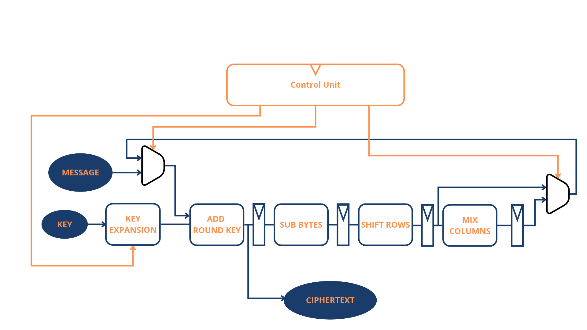

# Arquitetura MiniSoC AES

O sistema previsto contém RESET, PLL, SPI, CDC, banco de registradores, núcleo AES e subsistema de dados/memória. A base inclui o exemplo de reset e as transformações combinacionais AES verificadas nas semanas 02 e 03.

## Materiais desenvolvidos por Davi Augusto

Diagrama da arquitetura AES com unidade de controle, expansão de chave, transformações do estado, registradores, multiplexadores e realimentação:

[Vídeo da arquitetura — ADD ROUND KEY (1,67×)](assets/add_round_key_speed_1.67x.mp4).

Os arquivos foram fornecidos pelo autor e preservados sem alterações. O diagrama representa a arquitetura planejada; a implementação RTL entregue até a semana 03 cobre S-Box, SubBytes, ShiftRows, MixColumns e AddRoundKey. Expansão de chave e unidade de controle ainda serão integradas.

## Pontos de integração a confirmar

Antes de integrar o sistema, confirmar:

- Interfaces de topo: GLOBAL RESET, clock do oscilador, SPI IF e MEMORY DATA IF.
- AES: tamanhos de chave, cifração/decifração, ordem dos bytes e microarquitetura.
- SPI: modo, formato dos comandos, ordem dos bits e mapa de registradores.
- SPI no domínio SCLK; registradores/AES no domínio do sistema; travessia coerente de comandos e respostas.
- Reset por domínio, configuração padrão do PLL, sinal locked e reconfiguração.
- Interfaces dos modelos de PLL/memória compatíveis com o verificador.
- Biblioteca, frequências alvo e ferramentas disponíveis.

Domínios de potência, isolamento, retenção e sequências de energia serão definidos nas semanas 10–12. Esta página não constitui arquitetura aprovada.
