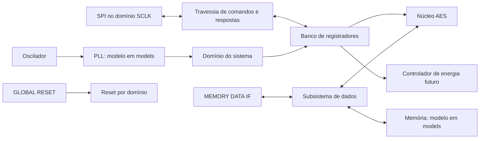

# Arquitetura inicial — pendente de especificação e aprovação

Esta página organiza o desenvolvimento; não é uma arquitetura v1.0 aprovada.

O RTL executável atual contém apenas `reset_sync` e um sinal `ready` de teste. Os demais blocos do diagrama são planejamento.

## Decisões a confirmar na semana 2

- Versões de AES, tamanhos de chave, cifração/decifração, ordem dos bytes e latência esperada.
- Nomes, larguras, polaridades e temporização das quatro interfaces finais.
- Modo SPI, framing, endereços, mapa de registradores e comportamento de erro.
- Interfaces dos modelos de PLL/memória compatíveis com a trilha de verificação.
- Clock após PLL, configuração padrão, locked e sequência de reconfiguração/reset.
- Microarquitetura iterativa por rodada ou alternativa, conforme desempenho requerido.
- Frequências alvo, biblioteca/PDK e ferramentas de lint/CDC.

## Clocks, CDC e reset

O SPI deverá deslocar bits, contar bits e gerar MISO no domínio SCLK. O banco de registradores e o AES deverão operar no domínio do sistema. Para comandos multibit, planejar handshake com dados estáveis ou FIFO assíncrona; sincronizadores independentes por bit não garantem coerência. Definir também travessia de respostas e comportamento quando SCLK para.

O reset deverá ter asserção assíncrona e liberação sincronizada em cada domínio. O exemplo implementa apenas o domínio `clk`; locked, reconfiguração e reset do SPI ainda não estão integrados. Revisar a sequência para não depender de configuração SPI antes de o PLL travar.

## Síntese, formal e potência

Modelos comportamentais ficam fora de `rtl/files.f`. No sistema final, preparar wrappers/macros ou caixas-pretas de PLL e memória consistentes entre síntese e Formality. O SDC final precisa declarar clocks do sistema/SCLK assíncronos e tratar CDC/reset conforme a arquitetura, sem esconder violações com exceções genéricas.

RESET, PLL e SPI são candidatos a domínio sempre ligado, a confirmar. Os domínios desligáveis, sinais de isolamento, retenção, tabela de estados e sequência de energia serão definidos nas semanas 10–12. Não há UPF implementado nem evidência de redução de potência nesta base.
